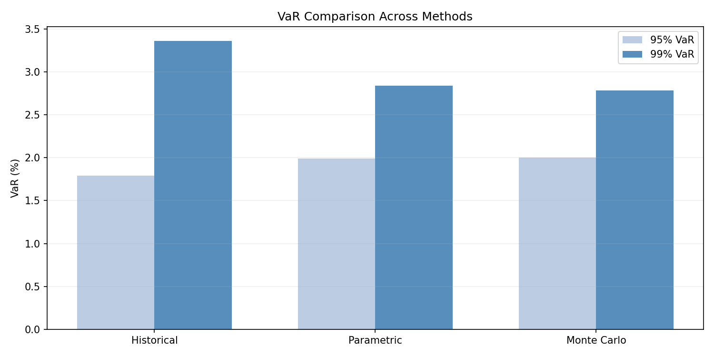
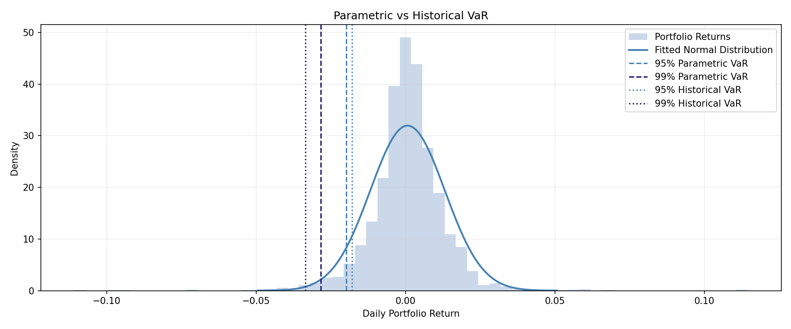
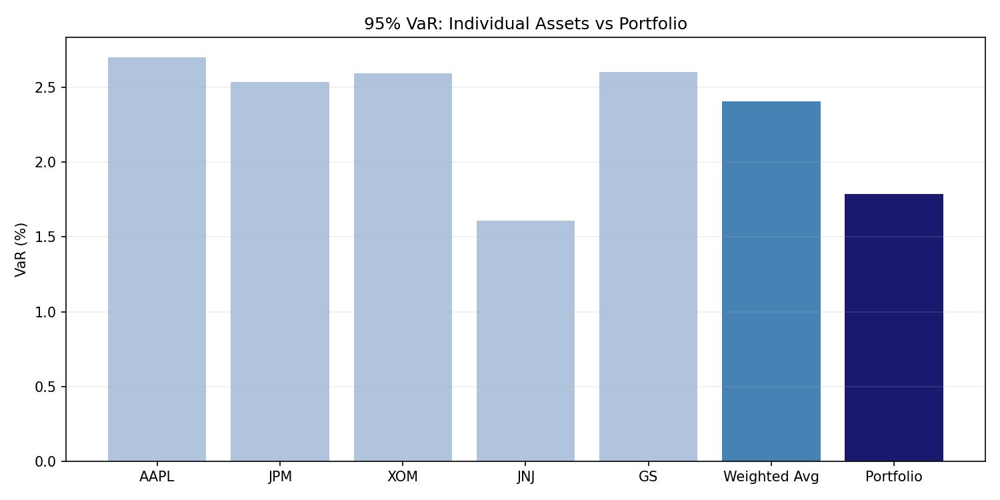
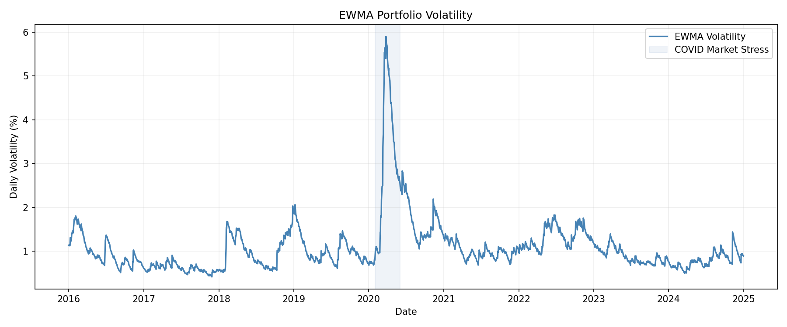
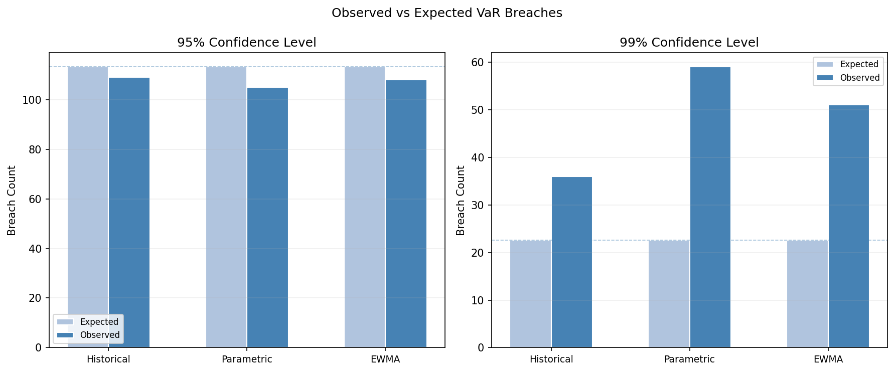
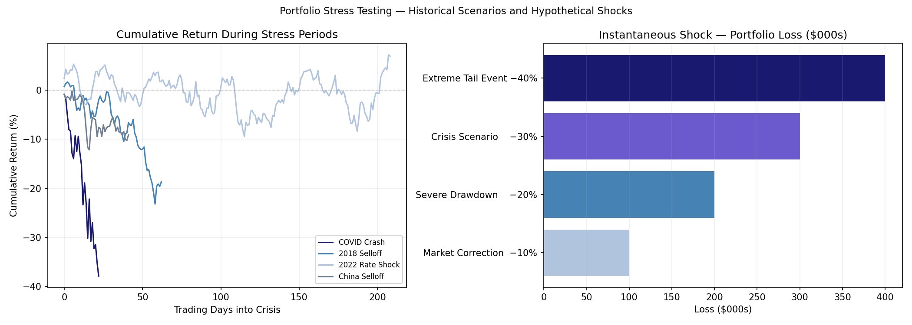

# Quant Risk Analytics Platform

Five assets across four sectors (technology, financials, energy and healthcare), ten years of daily data, and four ways of measuring how much a portfolio could lose in one day.

## About this project

I'm fascinated by financial markets, portfolio risk, volatility, and statistical machine learning. This fascination led me to develop a quantitative risk platform for a $1 million, five-asset portfolio, implementing Historical and Parametric VaR, Monte Carlo simulation, Expected Shortfall (ES), and EWMA-based volatility estimation at 95% and 99% confidence levels. I also applied the Kupiec and Christoffersen tests for VaR backtesting to understand how different risk estimation approaches performed against historical market data and whether observed VaR breaches were consistent with the models' predictions.

For me, the interesting part isn't just what the numbers tell us, but how models arrive at their results, the assumptions behind them, and how reliable and useful those results are in practice.

## The question

How much could this portfolio lose in one day, and how far can we trust that number?

| Term | Plain meaning |
|---|---|
| Value at Risk (VaR) | A one-day loss limit. A 95% VaR means the loss should be smaller than the limit on about 19 days out of 20. A 99% VaR means about 99 days out of 100. |
| Expected Shortfall (ES) | The average loss on the days that go past the VaR limit. It says how bad the bad days are. |
| Backtesting | Checking old forecasts against what really happened. Each day the forecast is made using only earlier data. |
| Breach | A day when the loss was bigger than that day's VaR limit. |
| Kupiec test | Asks whether the number of breaches is about what the confidence level promises. |
| Christoffersen test | Asks whether breaches are spread out or come in bunches, as they tend to in a crisis. |
| Stress test | Replays a real past crisis on the portfolio and looks at what it would have lost. |

## Results at a glance

- The four methods disagree. For a 95% one-day limit they range from $14,668 (EWMA) to $20,037 (Monte Carlo). For 99% they range from $20,745 (EWMA) to $33,584 (Historical).
- At 95%, every method had about the right number of breaches.
- At 99%, every method had too many breaches (36 to 59, against 22.6 expected). The 99% limits were too low.
- Only EWMA's breaches were spread out rather than bunched, at both levels. It still had too many breaches at 99%.
- On breach days the actual losses were larger than the ES forecast (1.10 to 1.33 times larger), so ES was underestimated by every method.
- In the COVID crash the portfolio lost 37.86% over the period. Its worst day was −11.08%, which is 3.8 times the 99% VaR that could have been calculated just before the crash.

## The portfolio

| Ticker | Company | Sector | Weight |
|---|---|---|---|
| AAPL | Apple | Technology | 20% |
| JPM | JPMorgan Chase | Financials | 20% |
| XOM | Exxon Mobil | Energy | 20% |
| JNJ | Johnson & Johnson | Health care | 20% |
| GS | Goldman Sachs | Financials | 20% |

Value $1,000,000. Daily prices from 2015-01-02 to 2024-12-30 (2,515 trading days, 2,514 daily returns), from Yahoo Finance. Average daily return 0.06%, standard deviation 1.25%.

JPM and GS are both Financials and move closely together (correlation 0.83), so the portfolio has four sectors, not five.

## What is inside

Seven notebooks, each building on the last.

**01 Data Pipeline.** Downloads daily prices and converts them into log returns. Every later notebook reads this file.

**02 Historical Simulation VaR.** Sorts the actual portfolio returns from worst to best and reads off the loss at the chosen confidence level. It assumes nothing about the shape of returns. It also measures the benefit of holding five stocks instead of one.

**03 Parametric VaR.** Assumes returns follow a normal (bell-curve) distribution and calculates VaR and ES from the portfolio's average return and covariance matrix.

**04 Monte Carlo VaR.** Simulates 10,000 possible days (seed 42) from a normal distribution with the historical averages and covariances of the five stocks.

**05 EWMA Volatility.** The RiskMetrics method with decay factor 0.94. Recent days count more than old days, so the estimate follows current market conditions. It starts from the first 250 days.

**06 Backtesting.** Compares the daily forecasts of Historical, Parametric and EWMA with what actually happened on the same 2,264 dates. Each forecast uses a rolling 250-day window (EWMA uses all earlier data) and only data up to the day before. Tests: Kupiec, Christoffersen, the two combined, and a check of ES on breach days. Monte Carlo is not backtested separately because, with normal returns, it gives the same result as Parametric.

**07 Stress Testing.** Replays four crises: COVID 2020, the 2018 selloff, the 2022 rate shock and the 2015 China selloff. Each is compared with a VaR calculated only from the 250 days before it began. It also applies simple instant shocks of −10% to −40%.

**Dashboard.** `app.py` is a Streamlit app that shows the same calculations and produces a PDF and JSON report. It was built with AI assistance. Its calculations are in `src/` and were checked against the notebook results.

## The numbers

All figures come from the notebooks in this repository. One-day horizon, $1,000,000 portfolio.

### VaR

| Method | 95% | 99% |
|---|---|---|
| Historical | $17,883 | $33,584 |
| Parametric | $19,886 | $28,393 |
| Monte Carlo | $20,037 | $27,843 |
| EWMA | $14,668 | $20,745 |



Historical VaR is lower than Parametric at 95% but higher at 99%. Real returns have more extreme days than a bell curve expects, and that shows up at the 99% level. EWMA is lowest because current volatility (0.89% a day) is below the ten-year average (1.25%). It describes today. The other three describe the whole ten years.



### Expected Shortfall

| Method | ES 95% | ES 99% |
|---|---|---|
| Historical | $28,914 (1.62x VaR) | $49,691 (1.48x VaR) |
| Parametric | $25,102 | $32,623 |
| Monte Carlo | $24,953 | $31,770 |
| EWMA | $18,394 | $23,767 |

### Diversification

Holding the five stocks together lowers the 95% historical VaR by $6,190 a day, compared with the weighted average of each stock's own VaR.





### Backtesting

2,264 daily forecasts per method, from 2015-12-31 to 2024-12-30.

| Method | Level | Expected breaches | Observed | Kupiec p | Christoffersen p | Combined p | Verdict |
|---|---|---|---|---|---|---|---|
| Historical | 95% | 113.2 | 109 | 0.6837 | 0.0002 | 0.0009 | CLUSTERED |
| Historical | 99% | 22.6 | 36 | 0.0094 | 0.0199 | 0.0023 | FAIL |
| Parametric | 95% | 113.2 | 105 | 0.4237 | 0.0001 | 0.0003 | CLUSTERED |
| Parametric | 99% | 22.6 | 59 | 0.0000 | 0.0000 | 0.0000 | FAIL |
| EWMA | 95% | 113.2 | 108 | 0.6135 | 0.4158 | 0.6322 | PASS |
| EWMA | 99% | 22.6 | 51 | 0.0000 | 0.1384 | 0.0000 | FAIL |

A p-value below 0.05 means the result is unlikely to be chance.

- **PASS:** right number of breaches, and not bunched.
- **CLUSTERED:** right number of breaches, but they come in bunches.
- **FAIL:** wrong number of breaches.

What this shows:

- At 95%, every method has about the right number of breaches. Historical and Parametric breaches bunch together in volatile periods. The Kupiec test alone cannot see this.
- At 99%, every method fails. A 99% limit should be broken about 22.6 times in 2,264 days, and these were broken 36 to 59 times. The likely reasons are fat-tailed returns, and, for fixed windows, slow reaction when volatility jumps.
- EWMA is the only method whose breaches are not bunched. It still breaks the 99% limit far too often.
- A test that does not reject a model does not prove the model is right.




### Expected Shortfall on breach days

On the days the VaR limit was broken, the actual average loss was bigger than the ES the model had forecast for those days. A ratio of 1.00x would be exact.

| Method | 95% | 99% |
|---|---|---|
| Historical | 1.12x | 1.10x |
| Parametric | 1.33x | 1.25x |
| EWMA | 1.20x | 1.17x |

All three methods underestimated tail losses. The normal-based methods did so the most.

### Stress testing

| Scenario | Window | Total return | Worst day | VaR 99% before the crisis | Worst day / VaR | Days of history used | Breaches (expected) |
|---|---|---|---|---|---|---|---|
| COVID crash | 2020-02-20 to 2020-03-23 | −37.86% | −11.08% | 2.94% | 3.8x | 250 | 12 (0.2) |
| 2018 selloff | 2018-10-01 to 2018-12-31 | −18.66% | −3.53% | 3.05% | 1.2x | 250 | 2 (0.6) |
| 2022 rate shock | 2022-01-01 to 2022-10-31 | +6.93% | −3.68% | 2.43% | 1.5x | 250 | 10 (2.1) |
| China selloff | 2015-08-01 to 2015-09-30 | −9.13% | −4.01% | 1.97% | 2.0x | 145 | 4 (0.4) |

- In the COVID crash the worst day was 3.8 times the VaR calculated before the crash, and that VaR was broken on 12 of 23 days. VaR is built from ordinary days, so it is not enough on its own.
- The 2022 window ended positive for this portfolio, so it is not a loss scenario here.
- The China benchmark uses only 145 days of history, so it is less reliable.

The four windows are well-known stress periods, with dates set by hand. As a cross-check, notebook 07 lists the portfolio's own largest peak-to-trough drops. The four largest overlap the four windows:

| Peak | Trough | Largest drop |
|---|---|---|
| 2020-01-17 | 2020-03-23 | −39.68% |
| 2018-09-20 | 2018-12-24 | −24.78% |
| 2015-06-23 | 2016-01-21 | −17.38% |
| 2022-01-11 | 2022-06-17 | −13.98% |

The notebook also applies instant shocks of −10%, −20%, −30% and −40%. These give losses of $100,000 to $400,000. They are just the shock times the portfolio value, and do not model how different sectors would behave.



## How the calculations are set up

- **Portfolio return.** Each day's portfolio return is the weighted sum of each stock's simple (percentage) return. The loss is the negative of that return. Every method, backtest and stress test uses this same series.
- **Constant weights.** Each stock is kept at 20% every day, which implies daily rebalancing.
- **Dollars.** Dollar figures are the loss fraction times $1,000,000.
- **No look-ahead.** A forecast for a given day uses only data up to the day before. The current EWMA volatility is the forecast for the next trading day.
- **Same dates.** All backtested methods are scored on exactly the same 2,264 dates.
- **Stress benchmark.** Each crisis is compared with a VaR from the 250 days before it started. A VaR from the full ten years would already contain the crisis.

## Limitations

- Parametric, Monte Carlo and EWMA assume normal returns. The 99% backtest shows this is a weak assumption for this data.
- All figures are for one day. There is no multi-day scaling.
- In a 250-day window only 2 to 3 days lie beyond the 99% level, and the historical 99% ES averages about 25 days. These estimates are noisy.
- ES is checked with a simple ratio on breach days, not with a formal significance test.
- The portfolio has only five large companies, chosen knowing that they did well over the period. JPM and GS are highly correlated.
- The instant shocks are simple multiples and the China benchmark uses only 145 days.
- Prices come from Yahoo Finance through `yfinance`, which is meant for research and education. Adjusted prices can be revised, so re-downloading may change figures slightly. The last price is 2024-12-30 because the download end date is exclusive.
- This is an educational project. It is not investment advice and not a regulatory capital model.

## How to run

Requires Python 3.10 or later.

```
pip install -r requirements.txt
```

**Notebooks.** Run 01 to 07 in order from inside the `notebooks/` folder. Notebook 01 downloads the prices and writes `data/log_returns.csv`. It needs an internet connection and no API key. Notebooks 02 to 07 write their charts to `reports/`.

**Dashboard.**

```
streamlit run app.py
```

The sidebar sets the portfolio value, assets, weights, date range and number of Monte Carlo simulations. The app reads `sample_data/log_returns.csv` (the dataset used in this README), then `data/log_returns.csv`, and otherwise downloads from Yahoo Finance. It checks the data first and stops if there are fewer than 500 trading days.

**Tests.** They need no data file.

```
python -m pytest -q
```

## Repo structure

```
├── notebooks/              # 01-07, run in order
├── reports/                # charts written by the notebooks
├── sample_data/
│   └── log_returns.csv     # the dataset used in this README
├── src/
│   ├── config.py           # shared settings
│   ├── data/               # loader.py, quality.py (data checks)
│   ├── risk/               # var_models.py, metrics.py
│   ├── validation/         # backtesting.py
│   ├── scenarios/          # stress_testing.py
│   ├── reporting/          # report_generator.py (PDF and JSON)
│   └── visualization/      # charts.py
├── app.py                  # dashboard home page
├── pages/                  # one page per method, backtesting, stress testing
├── ui_helpers.py           # sidebar and theme
├── tests/                  # test_core.py
├── pytest.ini
├── requirements.txt
└── README.md
```

## Built with

Python, pandas, NumPy, SciPy, matplotlib, Plotly, Streamlit, ReportLab, yfinance, pytest

## References

- Hull, J. *Options, Futures and Other Derivatives*, Chapter 22
- J.P. Morgan / Reuters. *RiskMetrics Technical Document*, 1996
- Kupiec, P. (1995). Techniques for Verifying the Accuracy of Risk Measurement Models. *Journal of Derivatives* 3(2)
- Christoffersen, P. (1998). Evaluating Interval Forecasts. *International Economic Review* 39(4)
- Basel Committee. *Supervisory Framework for the Use of "Backtesting" in Conjunction with the Internal Models Approach to Market Risk Capital Requirements*, 1996
