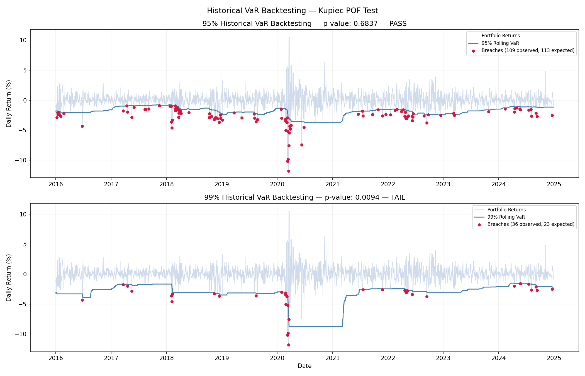

# Quant Risk Analytics Platform

Ten years of daily market data. Five stocks across five sectors: tech,
banking, energy, healthcare, and financials.

Risk management, at its core, comes down to one question: how much
could this portfolio lose, and how confident can we be in that number?
Value at Risk (VaR) answers the first part. It estimates the maximum
expected loss at a given confidence level, over a given time horizon.
What it does not answer is how bad the loss could get once that
threshold is breached. That is the domain of Expected Shortfall (ES),
which averages the losses in the tail beyond VaR instead of stopping
at a single cutoff. This project focuses on VaR. It builds four
different versions of the model, tests whether each one predicts
losses accurately using ten years of real data, and then places the
results against genuine market crises: the COVID crash, the 2018
selloff, and the 2022 rate shock, to see where each method holds up
and where it breaks down.

**The portfolio:** AAPL (tech), JPM (banking), XOM (energy), JNJ
(healthcare), GS (financials), equally weighted, using daily prices
from 2015 to 2024.

---

## Table of contents

- [What's inside](#whats-inside)
- [The numbers](#the-numbers)
- [How to run it](#how-to-run-it)
- [Repo structure](#repo-structure)
- [Built with](#built-with)
- [References](#references)

---

## What's inside

Seven notebooks, each building on the last:

**01 — Data Pipeline**
Downloads ten years of daily prices from Yahoo Finance and converts
them into log returns. Every subsequent notebook reads from this
output.

**02 — Historical Simulation VaR**
The most direct approach: sort the actual historical returns from
worst to best and read off the loss at the confidence level required.
No distributional assumptions, only what actually occurred.

**03 — Parametric VaR**
Assumes returns follow a normal distribution and computes VaR
analytically from the portfolio's mean and volatility. Faster to
compute than historical simulation, but less accurate in the tails,
where it matters most. That limitation is exactly what motivates the
Monte Carlo and EWMA approaches that follow.

**04 — Monte Carlo VaR**
Generates 10,000 simulated scenarios using the historical covariance
structure of the five stocks and estimates VaR from the resulting
distribution. Under normal conditions this converges with the
parametric result, but the same framework extends to far more complex
models, including non-normal return distributions.

**05 — EWMA Volatility**
Applies the RiskMetrics exponential weighting method (λ = 0.94), so
recent market movements carry more weight than older ones. The
resulting VaR estimate tracks current market conditions instead of a
fixed historical average. That distinction matters for a risk measure
that is supposed to be forward-looking.

**06 — Backtesting**
Validates whether the model performs as expected. Recomputes VaR
daily using a rolling one-year window, counts how often actual losses
exceeded the estimate, and applies the Kupiec test to determine
whether that breach frequency is statistically consistent with the
model's stated confidence level.

**07 — Stress Testing**
Evaluates how the portfolio performed during the most severe market
periods of the last decade: the COVID crash, the 2018 selloff, the
2022 rate shock, and the 2015 China correction. Also applies simple
instantaneous shocks to quantify direct dollar impact. This is the
kind of scenario analysis VaR cannot capture on its own.

---

## The numbers

**VaR on a $1,000,000 portfolio:**

| Method | 95% | 99% |
|--------|-----|-----|
| Historical | $18,059 | $34,243 |
| Parametric | $20,046 | $28,562 |
| Monte Carlo | $20,190 | $27,904 |
| EWMA (current) | $14,559 | $20,591 |

The EWMA estimate is lower than the others because current volatility
(0.89% per day) sits below the long-run average. That is the intended
behavior of the model: it reflects present conditions instead of a
fixed ten-year average.

**Backtesting:**

| Level | Expected breaches | Observed | p-value | Result |
|-------|------------------|----------|---------|--------|
| 95% | 113 | 106 | 0.48 | PASS |
| 99% | 23 | 32 | 0.06 | PASS |

Both levels pass the Kupiec test. The 99% result sits closer to the
threshold, which is expected. The model is being asked to predict a
rarer event with less data available to validate it.

**Stress testing:**

| Scenario | Total loss | Worst single day |
|----------|-----------|-----------------|
| COVID crash | −38.32% | −11.81% |
| 2018 selloff | −19.03% | −3.66% |
| 2022 rate shock | +4.81%* | −3.76% |
| China selloff | −9.28% | −4.10% |

*The 2022 rate shock ended positive over the full period, despite a
single-day loss of 3.76% at its worst point.

The COVID crash's single worst day recorded a loss of −11.81%. The
99% VaR over that same period was approximately 2.8%. That gap
reflects the limitation described earlier: VaR estimates the
threshold for a typical bad day but says nothing about severity
beyond it. That is exactly what Expected Shortfall is designed to
capture, and exactly why stress testing is included here as a
complement.

Diversification alone saves $6,317 per day at 95% confidence,
compared to holding each stock individually.



---

## How to run it

**Requirements:** Python 3.10+

```bash
pip install -r requirements.txt
```

Run the notebooks in sequence, `01` through `07`. Notebook 01 must run
first, since it generates the data files every other notebook depends
on.

A few notes before starting:
- Notebook 01 pulls live data from Yahoo Finance and requires an
  internet connection (no API key needed).
- Each notebook writes its output, processed data and charts, to
  `reports/`.
- Notebook 04 (Monte Carlo, 10,000 simulations) is the slowest of the
  seven and may take noticeably longer to run on a standard laptop
  CPU.

---

## Repo structure

```
├── notebooks/          # 01–07, run in order
├── reports/            # generated charts and output data
├── requirements.txt
└── README.md
```

---

## Built with

Python, pandas, NumPy, SciPy, matplotlib, yfinance

---

## References

- Hull, *Options, Futures and Other Derivatives*, Ch. 22
- J.P. Morgan, *RiskMetrics Technical Document*, 1996
- Hilpisch, *Python for Finance*, O'Reilly
- Basel Committee, *Supervisory Framework for Backtesting*, 1996
